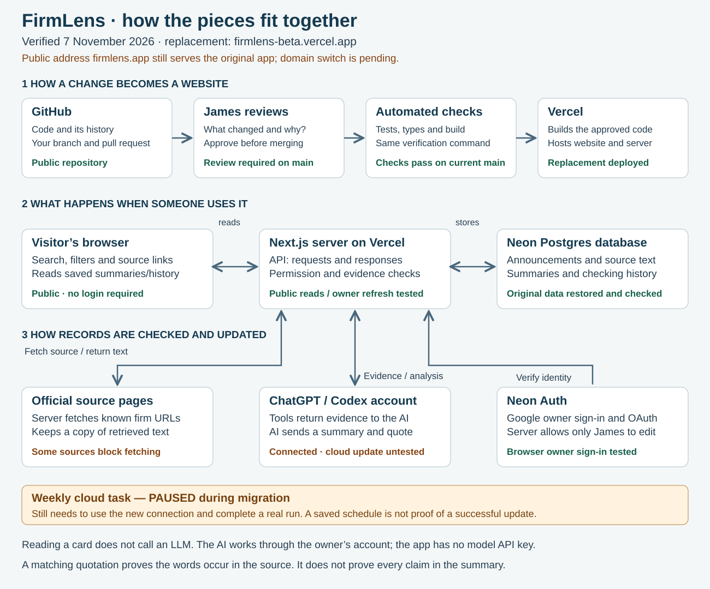

# FirmLens — how law firms say they use AI

[Use FirmLens](https://firmlens.app) · [Homework and agent prompts](homework/START-HERE.md) · [Step-by-step GitHub guide](CONTRIBUTING.md)

FirmLens collects law firms' public announcements about AI. You can search, filter, read saved summaries, open the original sources and inspect checking history. It records what firms say: an announcement is not independent proof that a product works or that a firm uses it well.

We built the first version together during the LegalQuants residency. This repository contains the replacement application and the material you need to understand it, question it and propose improvements.

## Residents: start by using it

**Your task is to exercise judgment and taste.** Try answering a real question with the site before asking an agent to inspect anything. Choose either route:

- **Feedback, no coding:** spend 15–20 minutes using the site. Post what you tried, what you noticed and what you would keep or change, with a reason and a link or screenshot.
- **Optional small PR:** choose one observation, investigate it with your coding agent, make one focused change and test it yourself. A pull request is a proposal for James to review; it does not publish your change. [Follow the setup and submission guide](CONTRIBUTING.md).

| Look at | Ask yourself |
|---|---|
| Accuracy | Does the original source support each important claim? Has a planned trial become a claimed firm-wide rollout? Are dates and figures attributed correctly? |
| Breadth | Which firms, jurisdictions or kinds of AI use are missing? Give a real source for a suggested addition. More entries are useful only if they belong here and can be checked. |
| Functionality | Can you answer your question using search, filters, sources and history? What useful action is missing or misleading? |
| UI and UX | Can you read, navigate and compare comfortably, including on a phone? Which wording, layout or interaction would you change, and why? |

You do not need to find a bug. A useful positive observation or a reasoned design preference counts. Do not submit a generic AI-generated code review. **You supply the observation and decide whether the proposed result is better.**

We will acknowledge contributions to the site, including useful feedback. Tell James how you would like to be credited; do not submit someone else's personal details.

## Architecture: what each part does



### Current status — checked 7 November 2026

**The source code is on GitHub; the hosting move is not yet complete.** The replacement runs at [firmlens-beta.vercel.app](https://firmlens-beta.vercel.app) on Vercel with Neon. The public address [firmlens.app](https://firmlens.app) still serves the original Sites application. Both can be inspected; say which URL you tested when reporting an issue.

| Part | Job | Evidence and remaining work |
|---|---|---|
| GitHub | Stores the code, its history and proposed changes. | Public. Main requires passing checks and a code-owner review, including for administrators. |
| Vercel + Next.js | Runs the replacement website and its server/API. The API handles reads, source checks and saving. | Deployed from GitHub. Public reads and an owner source refresh passed. Public-domain switch remains pending. |
| Neon Postgres | Stores announcements, retrieved source text, summaries and history. | All fields in the original export matched after import: 14 entries, 17 source snapshots and one settings row. A later owner refresh added a new snapshot. |
| Neon Auth | Verifies sign-in and AI-tool connections. The server then checks whether the identity is James's configured owner account. | Browser sign-in and owner refresh passed; anonymous and forged-identity writes were rejected. Public browsing needs no account. |
| ChatGPT / Codex tools | Let the owner's AI account read evidence and submit analysis. MCP is the tool connection; browser tools use the same application logic. | Desktop and ChatGPT connections approved. A complete native cloud read/analyse/save run against the replacement is still unproven. No model API key is bundled. |
| Weekly cloud task | Asks the agent to revisit sources and prepare updated analysis. | Paused during migration. Must be retargeted and tested before being called operational. |

[More detail and the original architecture](architecture.md) · [Deployment evidence and recovery](DEPLOYMENT.md)

### Follow one announcement

1. An owner starts a check of an existing official source URL. The server fetches it and saves the retrieved text and checking result.
2. ChatGPT or Codex asks a tool for that evidence and any previous differing text, then drafts a summary, a quotation and, where applicable, a change explanation.
3. The save tool checks the owner's permission, whether the snapshot is still current and whether the quotation appears in the source. It saves accepted analysis in the database.
4. Visitors read the saved result. **Opening a card does not call an LLM.**

This is why there is a server and a database: visitors see shared, persistent records with source history, while only the owner can update them. The coding agent that helped build the software and the AI that writes its summaries perform different jobs. Search, filters, sign-in and quote matching are ordinary code.

## What to question about the AI

- A matching quote does **not** establish that every sentence in the summary is supported. Check the whole claim against the source.
- The catalogue is curated, not exhaustive. Rechecking known URLs does not discover every new announcement.
- A changed page may only have a changed menu or footer. A fetch failure is not evidence that the announcement is false or has disappeared.
- Evidence supplied to the model is limited to 24,000 characters per current/previous text, without an explicit truncation flag.
- Good instructions are not the same as enforced rules. For example, pilot-versus-rollout wording is requested in the instructions, but not semantically checked by the save code.

[Read the actual AI instructions and checks](homework/AI-INSTRUCTIONS.md) · [Optional synthetic test cases](homework/AI-CASES.md)

## Find the part you want to understand

| Files | What to inspect |
|---|---|
| `app/`, `components/firmlens/` | Pages, search/filter interface, API routes and owner sign-in |
| `lib/source.mjs`, `lib/refresh.ts` | Source fetching, text extraction, quote validation and change recording |
| `lib/analysis.ts`, `lib/rpc.ts` | Evidence sent to the AI, instructions, tool definitions and saving analysis |
| `lib/access.ts`, `lib/mcp-auth.ts`, `lib/owner-policy.mjs` | Browser/tool authentication and owner permission rules |
| `lib/database.mjs`, `migrations/` | Database access and schema |
| `tests/` | Automated checks, including an isolated local database |
| `research/` | Original curated catalogue and source notes |
| `homework/` | Brief, prompts, review criteria, examples and diagrams |
| `reference/sites/` | Historical speed-build source; excluded from the replacement build |

## Run a safe local preview

Use Node **22.20.0** and npm **10.9.3**. If these are unfamiliar, use the setup prompt in [CONTRIBUTING.md](CONTRIBUTING.md).

```sh
npm ci
npm run verify
npm run dev:demo
```

Open the local URL printed in the terminal. The preview uses **three clearly labelled invented records**. It needs no hosting account, production database or AI credentials. It is read-only and does not test owner sign-in, production writes or model output. Keep the terminal running while you inspect it; Ctrl+C stops it. Set `PORT` if the default port is unavailable.

`npm run verify` checks the source-file limit, regeneratable diagram, tests, types and production build. It needs no production credentials and makes no model calls. Passing it does not prove that a summary is true or that the design is useful: inspect those yourself.

For backend work, use isolated fixtures or a separate development database. Do not copy James's credentials, run production migrations or change live records. PRs do not receive production secrets. James reviews changes before merging or releasing them. [Contribution guide](CONTRIBUTING.md) · [Project intent](intent.md) · [Agent rules](AGENTS.md)
