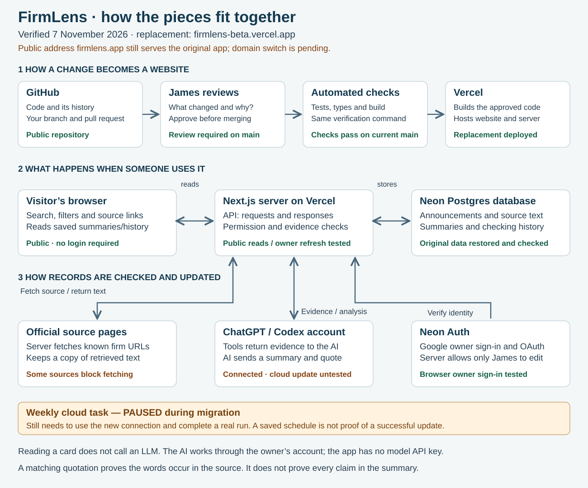

# FirmLens: what runs where

[The README contains the diagram, current status and resident starting points.](README.md#architecture-what-each-part-does)

## The two flows

**Using the app:** a visitor's browser requests records → the Next.js server reads Neon Postgres → stored summaries, sources and history appear. Browsing does not call an LLM or require a login.

**Updating an entry:** the owner asks the server to fetch a known official source → the server stores the retrieved text → ChatGPT/Codex reads evidence through an authenticated tool → it returns proposed analysis → the server checks permissions, current snapshot and quote match → accepted analysis is saved for everyone to read.

Neon Auth verifies the owner's identity. The server's own permission rule then restricts updates to the configured owner. A successful sign-in is not, by itself, editing permission. The browser and native MCP connection use different authentication paths but share the application logic.

## Where it runs

| Layer | Replacement | Original build |
|---|---|---|
| Code | Public GitHub repository, with reviewed PRs and required checks | Sites project; historical source preserved in `reference/sites/` |
| Website and server | Next.js on Vercel | Sites / Cloudflare |
| Database | Neon Postgres | Cloudflare D1 through Sites |
| Owner authentication | Neon Auth plus an explicit server-side owner check | Sites owner identity |
| AI worker | Owner's ChatGPT/Codex account through tools | Owner's ChatGPT/Codex account through tools |
| Public address as checked 7 November | `firmlens-beta.vercel.app` | `firmlens.app` |

The full original data export was restored and compared field by field. Browser owner sign-in and a source refresh on the replacement passed. Desktop and ChatGPT OAuth connections are approved, but a full native cloud read/analyse/save update has not yet been demonstrated. The weekly task is paused; the public-domain switch remains pending. See [deployment evidence and recovery](DEPLOYMENT.md).

## What the architecture does not guarantee

A database makes records persistent, not correct. A matching quote proves that the words occur in retrieved text, not that every claim in a summary follows from them. A checked build proves certain software checks passed, not that the interface is useful. A scheduled instruction is not evidence of a successful unattended run.

The app revisits a curated list of URLs. It does not yet continuously discover every new announcement. Some sources block fetching. Source packets sent to the model are truncated to 24,000 characters per current/previous text without an explicit flag. [Actual AI instructions and limits](homework/AI-INSTRUCTIONS.md).

## Locate your proposed change

| What you noticed | First place to investigate, without assuming the cause |
|---|---|
| Confusing dates, cramped cards, difficult mobile use | Interface components and the meaning of fields returned by the API |
| Search or filters miss a known entry | Interface filtering, stored categories and record data |
| A firm or jurisdiction is missing | Catalogue scope and real source availability |
| Summary overstates a trial or invents a figure | Retrieved evidence, source packet, AI instructions and save validation |
| Source check appears stale or failed | Fetch result, saved history and actual update workflow |

The coding agent helped make the software. The summary-writing AI is a separate worker using the tools the software exposes. These are two different uses of AI.

The [original diagram](homework/ORIGINAL-ARCHITECTURE.md) is retained for comparison. Buying a domain through Vercel did not itself move the original app to Vercel.

The SVG is generated from `scripts/render-diagram.mjs`; change that file and run `node scripts/render-diagram.mjs`. Verification compares the generated result with the committed image so they cannot silently drift.
