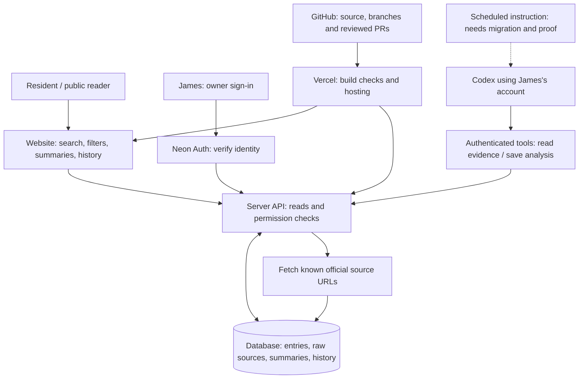

# FirmLens: what runs where

**Status, 7 November 2026:** the original app still serves `firmlens.app`. The replacement application is being checked before the domain moves. The Neon database restore matched all fields: 14 entries, 17 source snapshots and 1 settings row. A successful restore does not prove sign-in, AI-tool access or scheduling.

| Element | What it does | Status |
|---|---|---|
| Public page | Lets visitors search and read stored records without login. | Working on the original site; replacement built and awaiting live checks. |
| Server/API | Loads records, fetches known sources and controls writes. | Ported to Next.js; focused tests and build pass. |
| Neon Postgres | Retains the evidence and derived summaries, including history. | Full restore verified against original export. |
| Neon Auth | Identifies the owner; signing in alone does not grant editing rights. | Configured; Google callback and owner action need a live probe. |
| Source fetching | Revisits an already-curated URL and stores retrieved text. | Existing logic retained; this is not new-source discovery. |
| AI analysis | Codex reads a source packet, drafts a summary/change explanation, then calls a save tool. | Existing saved summaries retained. New authenticated connection still needs proof. No model API key is required by this implementation. |
| Save checks | Reject stale snapshots and invalid quotes; preserve history. | Deterministic checks retained. They do not prove every summary claim follows from the quote. |
| Weekly check | Tells an agent to repeat source checks and analysis. | Original schedule exists; replacement not yet verified. A schedule is not a successful unattended run. |
| GitHub/Vercel | Holds reviewable code and runs it on a hosting service. | Migration in progress; see DEPLOYMENT.md for release evidence. |
| Resident preview | Runs the public UI against three invented entries. | Local-only, read-only; no production credentials or model calls. |

**Follow one entry:** the server fetches an official announcement → stores the retrieved text → Codex reads that evidence → sends back a proposed summary and quote → the server checks permission, snapshot and quote → saves the result → everyone reads the stored result. Reading a card does not call an LLM.

**Two different uses of AI:** the coding agent helped write the application; separately, the owner's account prepares the summaries stored in it. Search, filtering, authentication, database writes and exact-quote matching are ordinary code.

**Where a resident's change belongs:** a clearer date label is usually interface work; a filter may involve interface and query logic; a misleading summary may arise from source retrieval, instructions, missing evidence or weak validation. Use the diagram to locate your observation, not to assume its cause.

The original diagram is preserved in [homework/ORIGINAL-ARCHITECTURE.md](homework/ORIGINAL-ARCHITECTURE.md). In the live session, Vercel initially managed the domain, while Sites/Cloudflare hosted the application. Buying a domain did not itself move the app. The migration changes the hosting and database, not that distinction.
