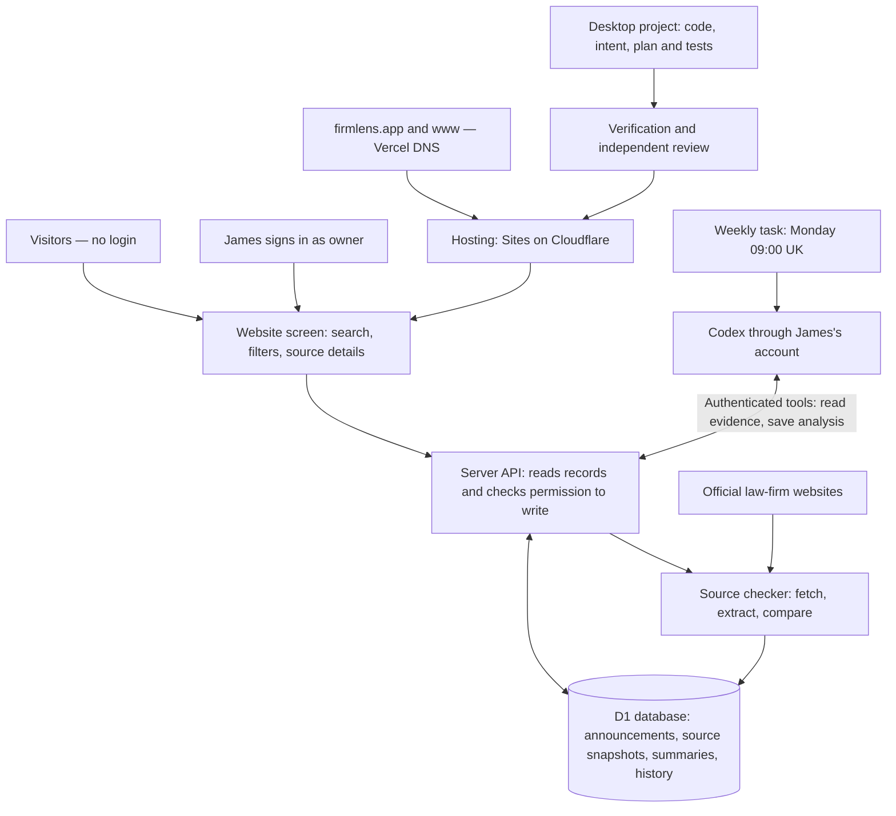

# FirmLens: what runs where

The website stores and displays the evidence. Codex does the AI analysis through James's account, then saves the results back. There is no model API key inside the app.

| Element | What it does | Proven status |
|---|---|---|
| Website screen (React/Vinext) | Lets anyone search firms, filter announcements and inspect the source and saved history. | Live. Desktop and narrow layouts checked. |
| Server API | Reads the database, performs source checks and accepts validated analysis. Browser commands and native MCP tools share the same checks. | Live. Anonymous, forged-owner and cross-origin write attempts rejected. |
| Owner sign-in | Uses Sites/ChatGPT identity to decide who may change records. | Live. Visitors need no account; owner commands require verified owner identity. |
| D1 database | Stores 14 announcements from 13 firms, original fetched HTML, extracted text, source versions, AI summaries and check history. | Live. Reload persistence, duplicate prevention and retained history tested. |
| Source checker | Fetches only approved official URLs; compares extracted-text hashes; records blocked or changed pages. | 12 sources checked successfully; two flagged for human review. Real unchanged check passed; changed-page logic tested with controlled fixtures. |
| Codex account | Reads current and prior evidence, writes a summary and change explanation, then saves an exact supporting quote against the current snapshot. | 12 saved AI summaries. Browser tool round-trip proven; native owner-only source read also proven. No paid model API dependency in the website. |
| Weekly task | Runs the source-check and account-analysis workflow on Mondays at 09:00 Europe/London. | Schedule enabled; first unattended run has not happened. |
| New-announcement discovery | Would find additional announcements and add them to the catalogue. | Not implemented. Current updates revisit known URLs. |
| Desktop project and release checks | Holds AGENTS.md, intent.md, plan.md, source, lockfile and canonical npm run verify command. Deploys the exact checked source through Sites. | Three saved releases; automated checks and independent review passed. |

Important limit: an exact supporting quote does not prove every sentence in an AI summary. The app distinguishes firm-reported claims from independent verification. Page furniture can also trigger a text-change signal; the AI explanation must distinguish that from a substantive announcement change.
