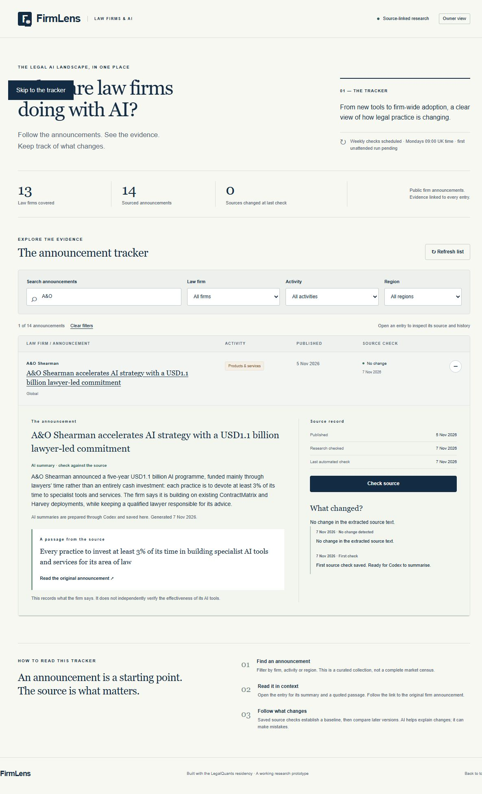

# FirmLens: try it, judge it, improve it

We built [FirmLens](https://firmlens.app) together on 7 November. Now use it and decide what would make it better. The point is your judgment and taste: what you notice, what matters to you, and what you choose to change.

**Choose either route. You do not need to code or create an account to take part.**

## Route 1 — try the site and give feedback

Allow about **15–20 minutes**. Open https://firmlens.app and click around. Start with a question you might actually want answered, such as “Which firms are using this AI tool?” or “Is this a trial or a firm-wide rollout?”

Tell us what you liked, what confused you, what felt missing, or what you would change. Think about four things:

- **Design:** Is it readable? Can you find what you need? Does it work comfortably on your phone?
- **Functionality:** Do the search, filters and links do what you expect? Is it useful for your question?
- **AI output:** Open an announcement and its original source. Does the summary accurately report what the source says? Does it leave anything important out or sound more certain than the evidence?
- **Breadth:** Which firms, jurisdictions or kinds of AI use should be included? Link to a real source for a suggested addition, and explain why it belongs in the tracker.

You do not need to review every feature or find a bug. A positive observation or a reasoned design preference is welcome. If a source will not open, say so rather than guessing what it contains.

Post a short message in the residency channel:

> I was trying to…  
> I noticed…  
> I would keep/change… because…  
> Here is the entry, link or screenshot…

**Use the site yourself before asking an agent.** An agent can help you investigate or express an observation, but it cannot supply your experience of using the app.

## Route 2 — turn one observation into a small pull request

Allow **45–90 minutes after account setup**, depending on your change. This is optional. A pull request, or PR, is a proposed change that James can inspect and accept, revise or reject.

1. Start with the same hands-on visit as Route 1. Choose **one** thing you observed. Write down what you tried, what happened and what you would prefer.
2. Follow the [step-by-step GitHub guide](../CONTRIBUTING.md): create an account, decide whether you want contributor access, send James your username and accept his invitation. You need no Vercel or Neon account.
3. Open a fresh chat with your coding agent in your local copy of the project. Give it your observation and the first prompt below. Read the diagram and relevant code together before changing anything.
4. Choose one small change. Ask the agent to implement it on your branch, using the second prompt. Check the result yourself in the browser. The agent saying “fixed” is not enough.
5. Open a PR. Show the original observation, the before/after result, the checks run and your own reason for preferring the change. **James will assess it before anything is merged or deployed.**

Examples of suitable changes, **if you actually encounter them**: clearer date labels, easier recovery from an empty search, a more usable mobile layout, a clearer explanation of missing evidence, or a test and fix for a summary rule that accepts an unsupported claim. A small visual change is valid: explain why you prefer it and show the result. You do not need to make the app more complicated.

### Prompt 1 — investigate my observation

```text
I used FirmLens and noticed this:
[My task, exact steps, what happened, and a screenshot or entry/source link.]

What I would prefer, and why:
[My own view.]

Read AGENTS.md, intent.md and architecture.md. Help me investigate this specific
observation. Do not start a general code audit or change files yet. Keep my
observation separate from your hypotheses. Explain which part of the app causes
the behaviour, and challenge my proposed change if it would make something worse.
Suggest the smallest useful change and how we could tell whether it helped.
Explain anything I need to decide in plain language. Do not access production
secrets, change live data or deploy.
```

### Prompt 2 — implement the change I chose

```text
The change I have chosen is:
[Describe one change and what the user should experience afterwards.]

Work on my resident branch, never main. Make only the changes needed for this
observation. Use the project's documented local setup and synthetic demo data;
do not connect my copy to James's live database or owner account.
Run npm run verify and add a relevant regression check where behaviour changes.
Show me how to open the local app and repeat my original task. Include a case
that could show your fix is wrong. Tell me what you could not test.
Do not push, open a PR or deploy yet. Explain the changed files so I can review
them, and stop for my decision before submitting anything.
```

After checking the result, you can tell the agent to commit, push **your branch** and prepare the PR. Read its description and changed files before submitting it. The [GitHub guide](../CONTRIBUTING.md) explains those steps.

## What James will look for

- You started with something you observed while using the site.
- You can explain why it matters, or why you prefer your alternative.
- Where AI makes a claim, you checked the evidence rather than trusting its wording.
- Your proposed change is small enough to understand and assess.
- You checked the result yourself and can say what remains uncertain.

There is no reward for the longest issue list, the most code, or finding fault for its own sake. An agent's suggestion is a suggestion; deciding whether it improves the app is your job.

## How this follows the session

At **10:11** we framed the exercise around judgment and taste. At **12:48** we discussed how seeing a working app reveals better questions. At **75:45–76:42** we invited you to try FirmLens and suggest changes. At **81:49–85:22** we inspected the AI instructions and discussed why a genuine quotation does not necessarily support the whole summary. At **87:10–89:49** we discussed slowing down, inspecting the build and testing whether a claimed improvement really works.

This homework is that next step: use it, notice something, then decide what deserves to change.

[Architecture and current status](../architecture.md) · [AI instructions and their limits](AI-INSTRUCTIONS.md) · [Optional AI test cases](AI-CASES.md) · [Review questions](ASSESSMENT.md)



Screenshot from the original 7 November build. The owner-only source-check button shown here is not required for the homework.
